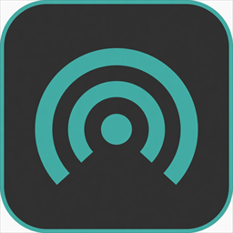
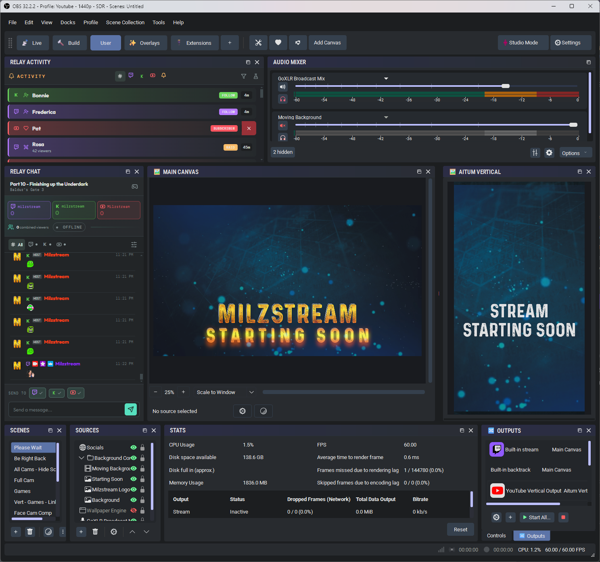
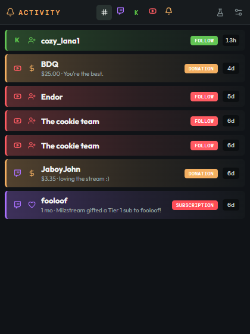
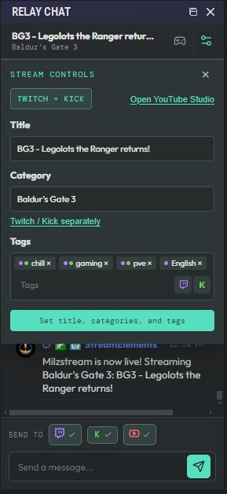
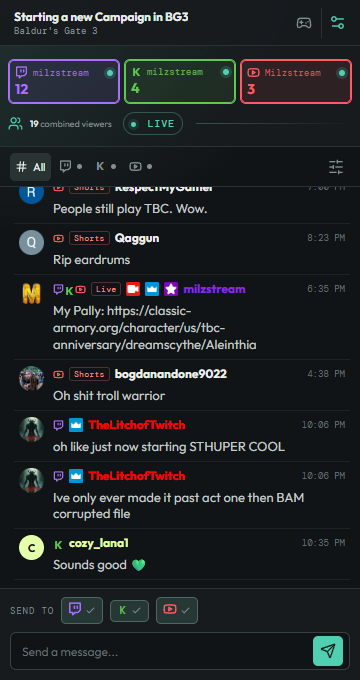
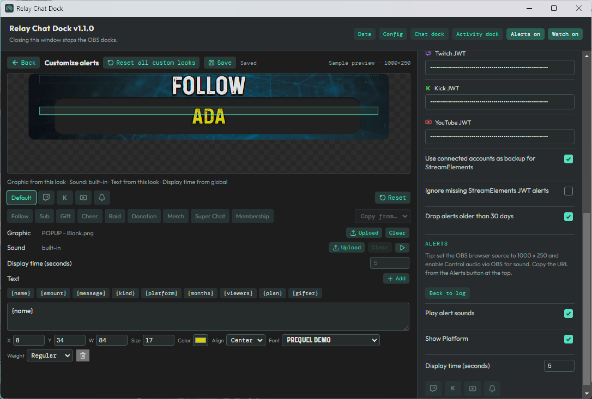

  

<h1 align="center">Relay Chat Dock</h1>

---

A local OBS companion with three pieces: a unified chat dock, a unified activity dock, and an alerts browser source you can customize.

  
  
  
  

  

  
  

  

  

## Features

- One OBS chat dock for Twitch, Kick, and YouTube, with filters, emotes, highlights, and moderation
- Activity dock for follows, subs, gifts, cheers, raids, Super Chats, memberships, merch, and donations
- On-stream alerts, with a look editor in the companion window
- Shared Twitch and Kick title, category, and tag controls
- Optional English translation of non-English chat
- Readonly LAN watch link from the companion window

## Download

The latest Windows build is on the [Releases](https://github.com/Milzstream/OBS-Multi-Chat/releases/latest) page. Use the installer. A portable zip is on the same release.

Install steps, where `production.env` and `data\` live, and why an older build is not guaranteed after a provider change: [Install](docs/install.md).

## Docs

- [Install](docs/install.md) — installer, portable zip, data folder, updates, and the LAN watch link
- [Setup](docs/setup.md) — Twitch, Kick, YouTube, translation, and `production.env`
- [Docks](docs/docks.md) — chat, stream controls, emotes, highlights, and moderation
- [Activity](docs/activity.md) — the activity dock and how to test alerts
- [Alerts](docs/alerts.md) — on-stream alerts and the look editor
- [Develop](docs/develop.md) — run from source, package, and backend endpoints

## License

Source-available under the MIT License with the [Commons Clause](https://commonsclause.com/). You may use it on your own stream, including a monetized one. You may not sell it or offer it as a paid product or hosted service. See [LICENSE](LICENSE).

## For contributors

Operator setup is in the docs above. The coding map is [AGENTS.md](AGENTS.md). A short process sketch is [docs/architecture.md](docs/architecture.md).
