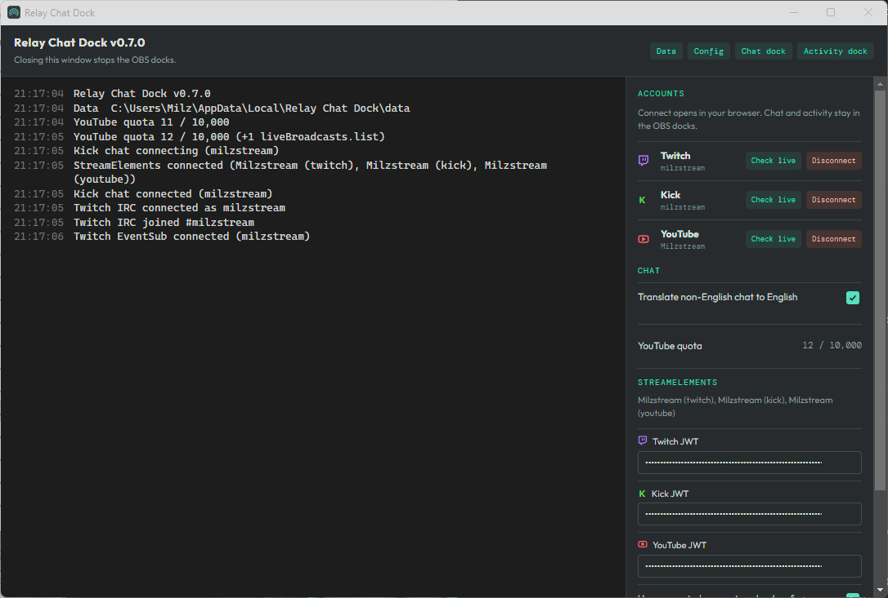

# Relay Chat Dock

A local OBS companion that combines Twitch, Kick, and YouTube live chat into one dock, plus an Activity dock for follows, subs, gifts, cheers, raids, Super Chats, memberships, merch, and StreamElements donations.

Windows ·  · 

## Features

- One OBS chat dock for Twitch, Kick, and YouTube, with filters, emotes, highlights, and moderation
- Activity dock for follows, subs, gifts, cheers, raids, Super Chats, memberships, merch, and donations
- On-stream alerts, with a look editor in the companion window
- Shared Twitch and Kick title, category, and tag controls
- Optional English translation of non-English chat
- Readonly LAN watch link from the companion window

## Download

The latest Windows build is on the [Releases](https://github.com/Milzstream/OBS-Multi-Chat/releases/latest) page. Use the installer. A portable zip is on the same release.

Install steps, where `production.env` and `data\` live, and why an older build is not guaranteed after a provider change: [Install](docs/install.md).

## Docs

- [Install](docs/install.md) — installer, portable zip, data folder, updates, and the LAN watch link
- [Setup](docs/setup.md) — Twitch, Kick, YouTube, translation, and `production.env`
- [Docks](docs/docks.md) — chat, stream controls, emotes, highlights, and moderation
- [Activity](docs/activity.md) — the activity dock and how to test alerts
- [Alerts](docs/alerts.md) — on-stream alerts and the look editor
- [Develop](docs/develop.md) — run from source, package, and backend endpoints

## License

Source-available under the MIT License with the [Commons Clause](https://commonsclause.com/). You may use it on your own stream, including a monetized one. You may not sell it or offer it as a paid product or hosted service. See [LICENSE](LICENSE).

## For contributors

Operator setup is in the docs above. The coding map is [AGENTS.md](AGENTS.md). A short process sketch is [docs/architecture.md](docs/architecture.md).
