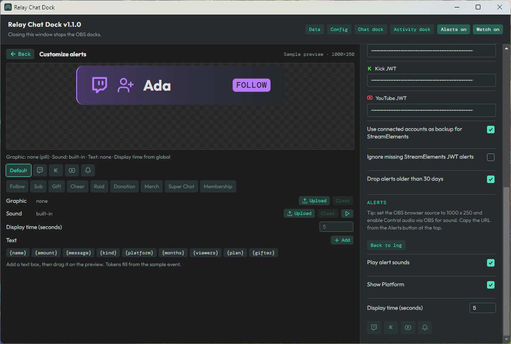
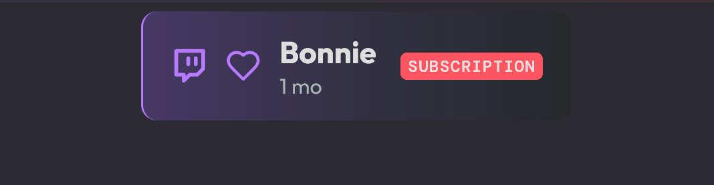
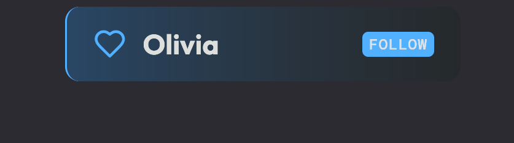

# Alerts

[README](../README.md) · [Install](install.md) · [Setup](setup.md) · [Docks](docks.md) · [Activity](activity.md) · [Develop](develop.md)

Click **Alerts** in the companion window to turn on `http://localhost:4173/alerts` (off by default; right-click **Alerts on** to copy the URL). Add it as one OBS **Browser** source. The page is transparent, ignores alerts already in the feed when it loads (so an OBS refresh does not replay), and shows each new alert one at a time in arrival order. The activity pill is the default.

Click **Customize** in the companion Alerts section to replace the log with a look editor (Back restores the log). **Save** writes the look. **Reset to default** removes the current look so Default uses the built-in pill again, and a platform or kind tab drops that override. The overlay URL stays output-only: do not add `?edit=` to the browser source.

A saved look (graphic, video, placed `{token}` text with a font, or sound) plays instead of the pill. Customize lists Outfit plus the fonts installed on this PC (including ones you installed for your user), and the overlay uses those same family names so OBS on this computer can render them. Fields inherit from default, then platform, then kind, then platform and kind. A look with only a sound still uses the pill.

Tokens include `{name}` `{amount}` `{message}` `{kind}` `{platform}` `{months}` `{viewers}` `{plan}` `{gifter}`. Empty values collapse, so `{name} cheered {amount}` becomes `Ada cheered 100 Bits` or just `Ada cheered` when there is no amount. Custom files live in `data/alerts/` and are served from `/alerts/assets/`. Clearing a graphic or sound, or Reset to default, drops files that no look still references.

The queue holds as many alerts as the activity feed does; past that the oldest waiting ones are dropped. The **Alerts** section in the companion settings has a sound toggle (one short built-in clip per group: follow, sub/member, cheer/KICKs, donation/merch, Super Chat, raid), **Show Platform** (on by default; turn it off to hide platform icons and colors and use generic labels, so a YouTube subscriber reads FOLLOW and a member reads SUBSCRIBER), the display time (default 5 seconds), and platform buttons that open each platform's alert types so you can uncheck the ones to skip.

A gift bomb plays as one alert (the gifter). Gifted subs under that gift do not each play. A gifted sub with no gift row nearby plays once as a gift. Twitch Power-ups do not play here. Enable **Control audio via OBS** on the browser source or the sound never leaves the page.

The pill and custom banners scale with the browser source: its width and height set the size, so a 1000 x 250 source gives a roughly 800 px wide pill, and a bigger source makes a bigger banner. Use a wide, short size like that, place the source where you want alerts, and avoid a tiny one. The flask icon in the Activity dock emulates alerts, which also play here. How to fire a test is in [Activity](activity.md).

